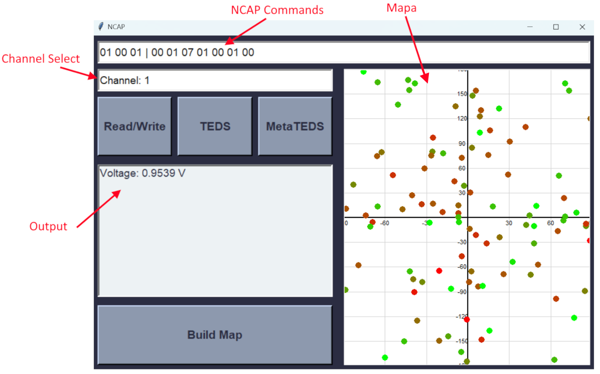
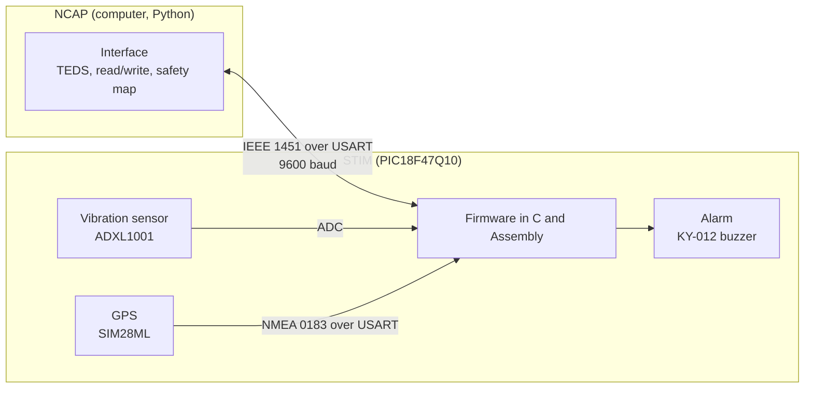

# IEEE 1451 cyber-physical system for vehicle damage detection

A prototype smart-city system that detects vibrations on parked cars (impacts or
break-in attempts), reports where they happened and sounds an alarm. A PIC18
microcontroller acts as an IEEE 1451 smart transducer, and a Python program on a
computer acts as the central station that reads it and builds a safety map of
the city.



## Architecture



Following IEEE 1451, the microcontroller board is the **STIM** (Smart
Transducer Interface Module), which holds the transducers, the signal
conditioning and the analogue-to-digital conversion. The computer is the
**NCAP** (Network Capable Application Processor), which talks to the STIM and
presents the data to the user.

Only the microcontroller was physical. The other components were chosen for a
real deployment and then emulated.

- **Vibration sensor.** An ADXL1001 accelerometer, emulated with the board's
  potentiometer on pin RA0 and read through the ADC.
- **GPS.** A SIM28ML module, emulated by [`gps.py`](host/gps.py), which answers
  position requests over a USB to serial adapter with GLL position messages
  built with `pynmeagps`.
- **Alarm.** A KY-012 piezo buzzer, emulated with an LED on pin RA4.

## Firmware

The firmware in [`firmware.X`](firmware.X) is an MPLAB X project for the
PIC18F47Q10 on a Curiosity High Pin Count board, running at 32 MHz.

- **Configuration in Assembly.** It sets up the clock, the pins, two USARTs at
  9600 baud, the ADC and Timer0.
- **Interrupt driven.** The main loop stays idle and reacts to four
  interrupts, namely end of ADC conversion, a byte from the NCAP, a byte from
  the GPS, and a Timer0 timeout for incomplete messages.
- **IEEE 1451 commands.** It answers requests for the Meta-TEDS and for each
  channel's TransducerChannel TEDS, reads the sensors and writes to the alarm.
- **Error handling.** Unknown commands, missing channels, reading an actuator or
  writing to a sensor all return the standard error reply, and incomplete
  commands are dropped after a timeout.

## Central station

[`interface.py`](host/interface.py) is a Tkinter application that

- requests the TEDS and Meta-TEDS from the STIM,
- reads the sensor or writes to the actuator on a chosen channel,
- shows every command and the start of every reply,
- and with **Build Map**, repeatedly reads the position and the vibration and
  plots each point from green (safe) to red (unsafe), sounding the alarm when
  the vibration is too high.

## Response time

A position takes about 0.26 s to travel from the GPS to the central station,
dominated by the GPS update rate (5 Hz) and the length of an NMEA sentence at
9600 baud. The ADC conversion takes 44 µs and the read command 7 ms, so neither
limits the system.

## Running it

You need the PIC18F47Q10 board flashed with the firmware, connected to the
computer, plus a USB to serial adapter on the second USART for the emulated GPS.

```bash
pip install -r host/requirements.txt
python host/two_scripts.py      # starts the interface and the GPS emulator
```

The serial ports are set at the top of each script (`COM3` for the board and
`COM5` for the GPS adapter). Change them to match your machine.

## Repository layout

```
firmware.X/     MPLAB X project (C and Assembly) for the PIC18F47Q10
host/           central station interface and GPS emulator (Python)
docs/           full project report, in Portuguese
assets/         images for this README
```

## Credits

Advanced Instrumentation course, MSc in Engineering Physics, University of
Minho, 2024/25, by Gabriel A. Pedrosa and João P. R. Ferreira. The firmware
started from the course's PIC18 example project.
